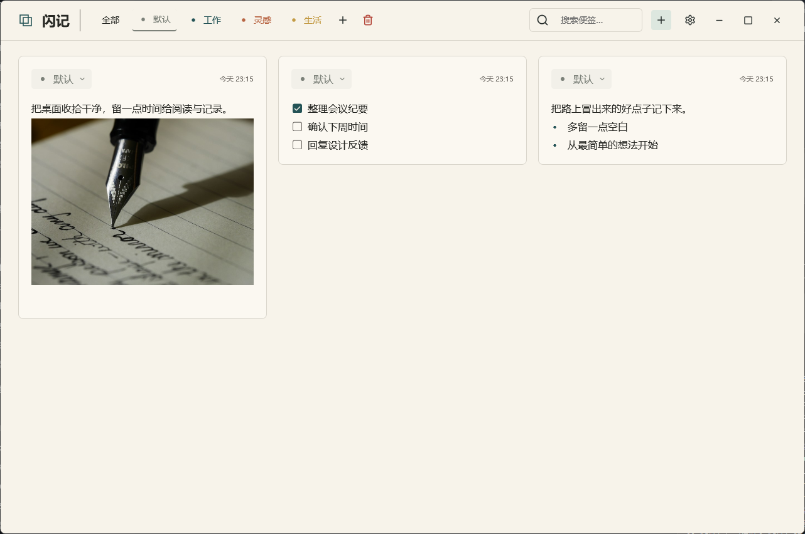
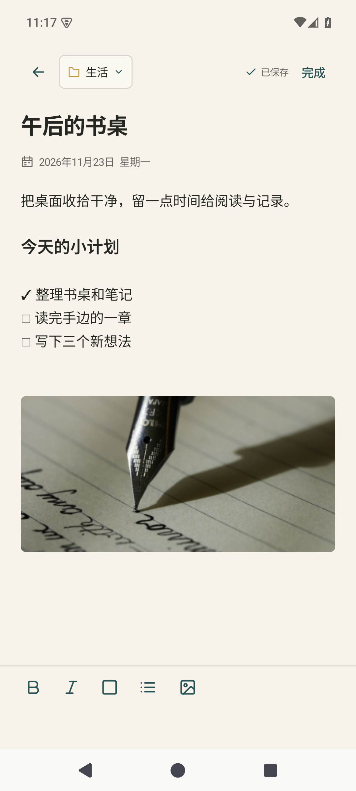

# 闪记 FlashNote

这个时代，你的灵感最重要!

基于 Rust 与 GPUI 的轻量级便签软件，毫秒级极速启动，可自部署同步服务

**[下载闪记（Windows、Linux、Android）](https://github.com/Puring103/FlashNote/releases/latest)**

## 特性

项目的核心代码、数据模型、加密边界与双端同步流程见[核心架构与同步设计](docs/核心架构与同步设计.md)。审查记录、交互约定和运维说明收录在[设计文档导航](docs/README.md)。

- 极速启动，启动速度约 100ms
- 命令行工具，让 agent 操作和读取你的便签
- 完整支持markdown语法
- 随时随处打开便签，快速记录灵感
- 按分组整理，输入关键词查找，也能恢复误删的便签
- 在桌面端录音并转成文字
- 支持自部署同步服务，在不同设备之间同步便签

## 应用截图



| Windows 便签 | Android 便签列表 | Android 编辑便签 |
| :---: | :---: | :---: |
|  |  |  |

## 自建同步服务器

在 Linux 服务器上安装 Docker Compose，开放 TCP 80、443。使用域名时，将 DNS 指向服务器。

获取 [`sync-server/` 部署文件](https://github.com/Puring103/FlashNote/tree/main/sync-server)：

```sh
git clone --depth=1 --filter=blob:none --sparse https://github.com/Puring103/FlashNote.git
git -C FlashNote sparse-checkout set sync-server
cd FlashNote/sync-server
cp .env.example .env
```

将 `.env` 中的 `SUOJIAN_ORIGIN` 填为自己的 HTTPS 域名或公网 IP，然后运行 `docker compose up -d --build`。

用 `sudo cat .casdoor/initial-account.json` 查看初始账号和密码，在桌面端「设置 → 账号与同步」或 Android 端「我的」填写服务器地址和凭据。

新部署默认关闭公开注册、启用端到端加密。首次创建资料库时，请在账号设置中查看并保存 12 个助记词。新设备登录后需输入这些词才能解密；能用的旧设备可再次显示或复制。服务器仍可见对象标识、大小和同步时间，本机便签与导出 ZIP 为明文。

注册开关、加密模式、备份、恢复和升级步骤见[同步服务运维指南](sync-server/README.md)。

## 许可证

项目原创代码采用 [MIT 许可证](LICENSE)。第三方组件和素材沿用各自的许可。
